<div align="center">

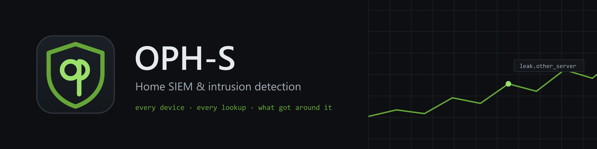

[](https://github.com/op-h/OPH-S/actions/workflows/ci.yml)
[](https://github.com/op-h/OPH-S/releases)


**A home SIEM and intrusion-detection system that sees every device on the network from one Windows PC, and tells you what got around your protection.**

[Install](#install) · [Features](#what-it-does) · [Leak Check](#leak-check) · [Architecture](#architecture) · [Build](#build)

</div>

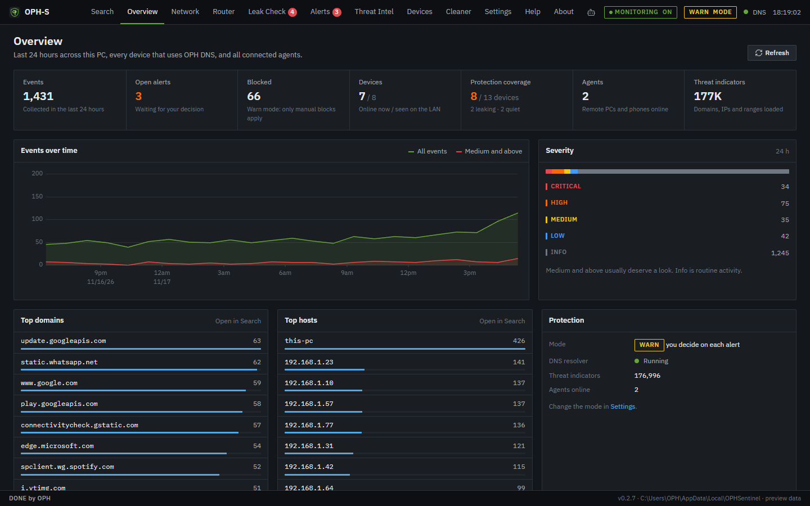

## What it does

OPH-S becomes the DNS resolver for your router. Every phone, TV, console and laptop is then visible with nothing installed on it. On the PC it adds Windows' own per-program DNS events, live connections and file monitoring, and correlates everything in a Splunk-style search.

| | |
|---|---|
| **Whole-house visibility** | Every lookup from every device through a built-in resolver and sinkhole (written in Rust on `hickory-proto`), with a per-device query history. |
| **Leak Check** | Compares independent views of the same traffic and names the program or device that bypasses protection. [More below](#leak-check). |
| **Threat intelligence** | Phishing.Database, OpenPhish, Feodo Tracker, Spamhaus DROP and URLhaus. False positives are filtered with the Public Suffix List and a platform-aware Tranco top-sites guard. |
| **Search** | Query language with autocomplete, quick filters (Threats, VPN, PD), stats, include/exclude per value, saved searches and CSV export. |
| **Ask AI** | Explains a search, alert or device with Claude (API key) or a local model through Ollama. Log content is passed as untrusted data, with an optional mask for local IPs and MACs. |
| **Endpoints** | A Rust agent for other PCs and a Kotlin Android app (DNS-only VPN, per-app attribution). Both use TLS with certificate pinning and per-device revocable keys. |
| **Router control** | Configures a TP-Link Deco over its local API (address reservation, DHCP DNS), with a read-only check, backup and undo. |
| **Housekeeping** | File-integrity monitoring of Startup and Downloads, a cleaner with quarantine and undo, logs on an external drive with automatic fallback. |

## See it

<table>
<tr>
<td width="50%"><b>Search</b>: autocomplete, VPN filter, stats by device<br>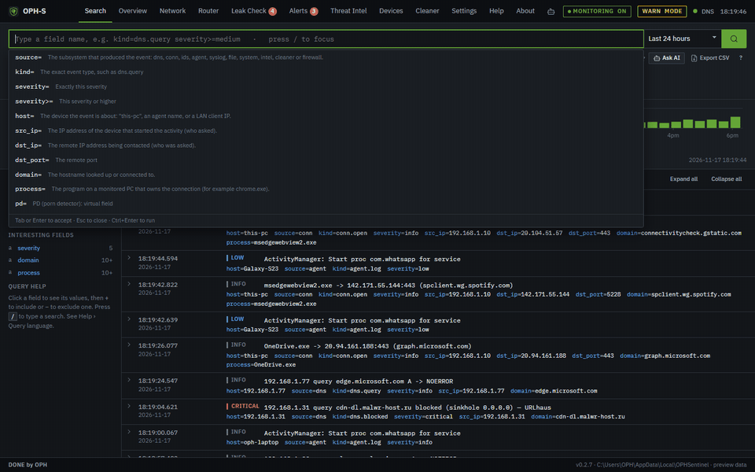</td>
<td width="50%"><b>Leak Check</b>: coverage, leak cards, one-click fixes<br>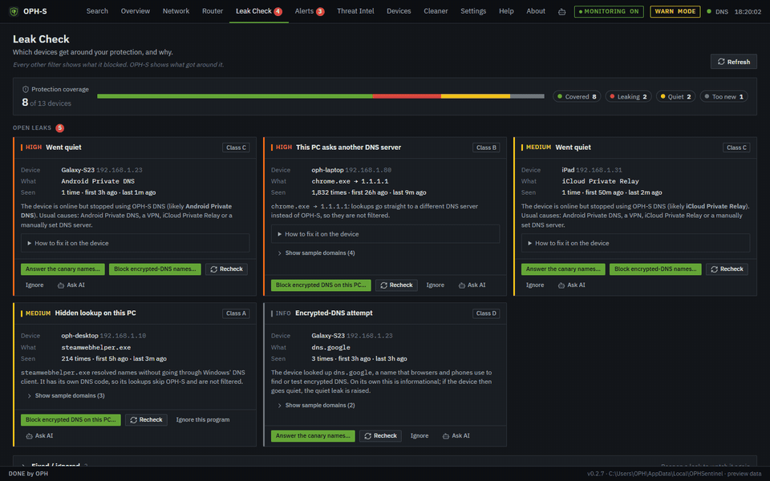</td>
</tr>
<tr>
<td>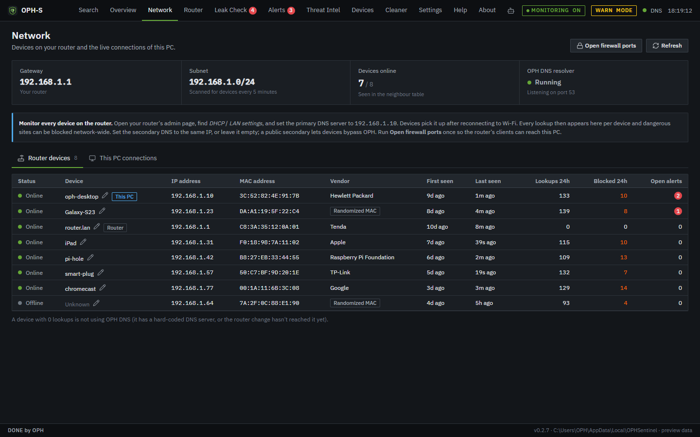</td>
<td>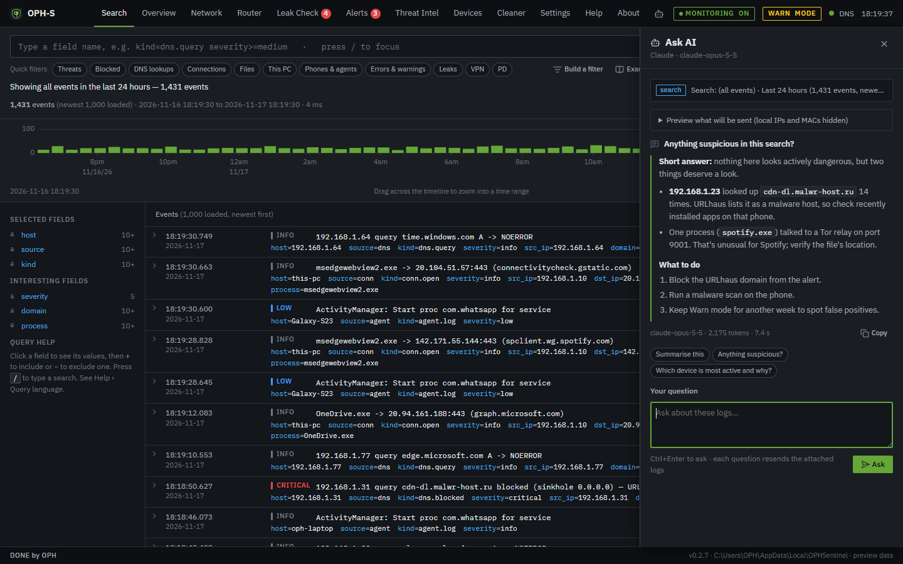</td>
</tr>
<tr>
<td>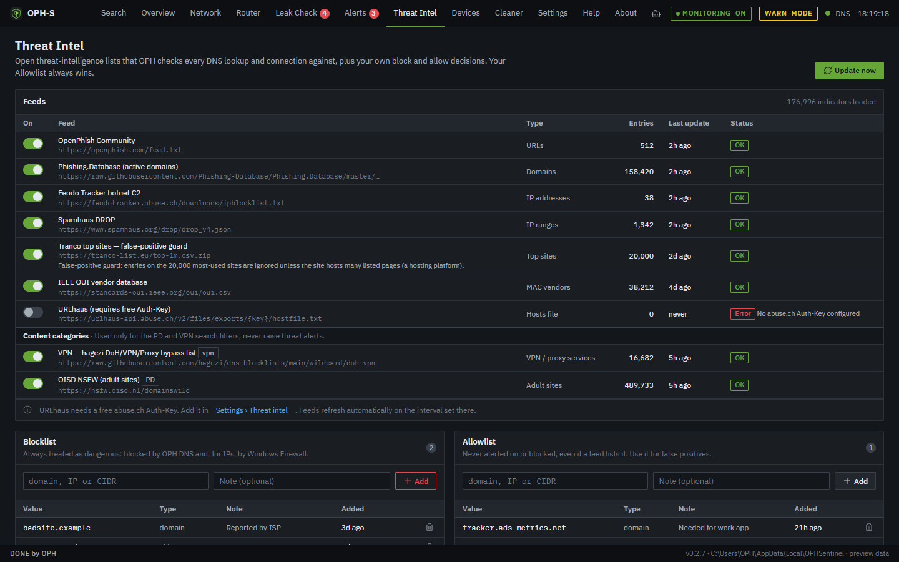</td>
<td>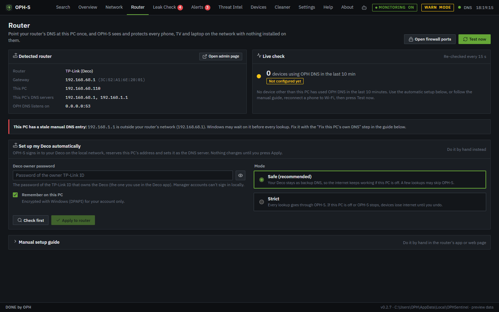</td>
</tr>
<tr>
<td>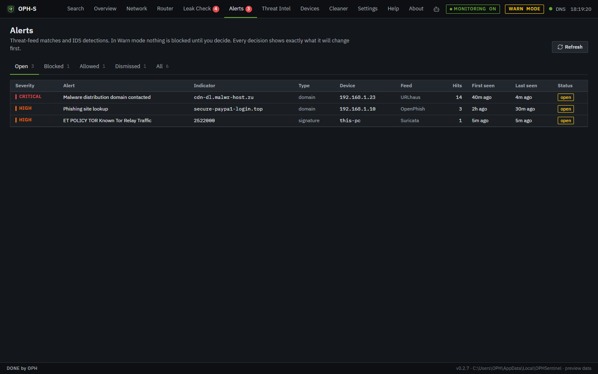</td>
<td>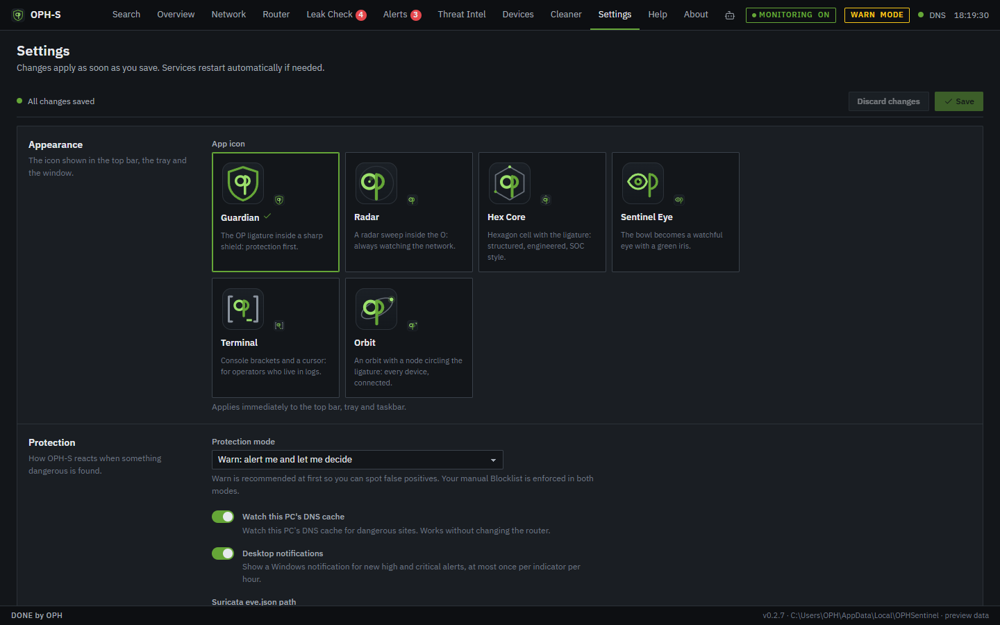</td>
</tr>
</table>

Short videos: [search](docs/media/search-flow.mp4) · [Leak Check](docs/media/leak-check.mp4) · [name animation](docs/media/brand-hover.mp4). All media is generated from the UI's demo mode by [`docs/media/capture.mjs`](docs/media/capture.mjs) and contains no real user data.

## Leak Check

> Every other filter shows what it blocked. OPH-S shows what got around it.

Filters such as Pi-hole, AdGuard Home and NextDNS see only the network side, and they document that encrypted DNS and VPNs blind them. Host firewalls see only one computer. OPH-S has both views at once, so it compares them:

| Detector | Signal | Example finding |
|---|---|---|
| **A** Hidden lookup | The resolver got a query from this PC that Windows' DNS client never sent (ETW 3019/3010 within ±2.5 s). The program is identified from the source port. | `steamwebhelper.exe` uses its own DNS code |
| **B** Another DNS server | ETW 3010 shows a server that is not OPH-S, or a socket to a public DoH/DoT resolver | `Telegram.exe` uses DNS-over-HTTPS to 8.8.8.8 |
| **C** Went quiet | A device is online in ARP but stopped querying, measured against its own 14-day hourly baseline | A phone switched to Android Private DNS |
| **D** Encrypted-DNS attempt | Lookups of DoH bootstrap names and the Firefox / iCloud Private Relay check names | `dns.google` looked up just before going quiet |

Fixes are honest about scope:
- **Block encrypted DNS on this PC** through Windows Firewall.
- **Answer the Firefox and Private Relay check names with NXDOMAIN.** A `0.0.0.0` answer does not disable them.
- **Block DoH services house-wide.**
- **Recheck,** which closes a card once the leak is gone.

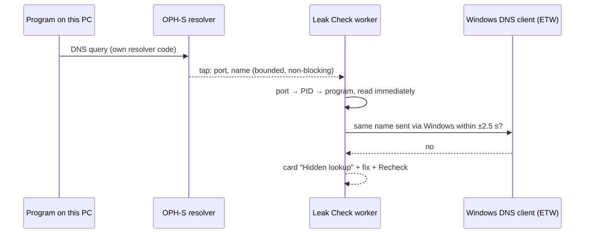

## Architecture

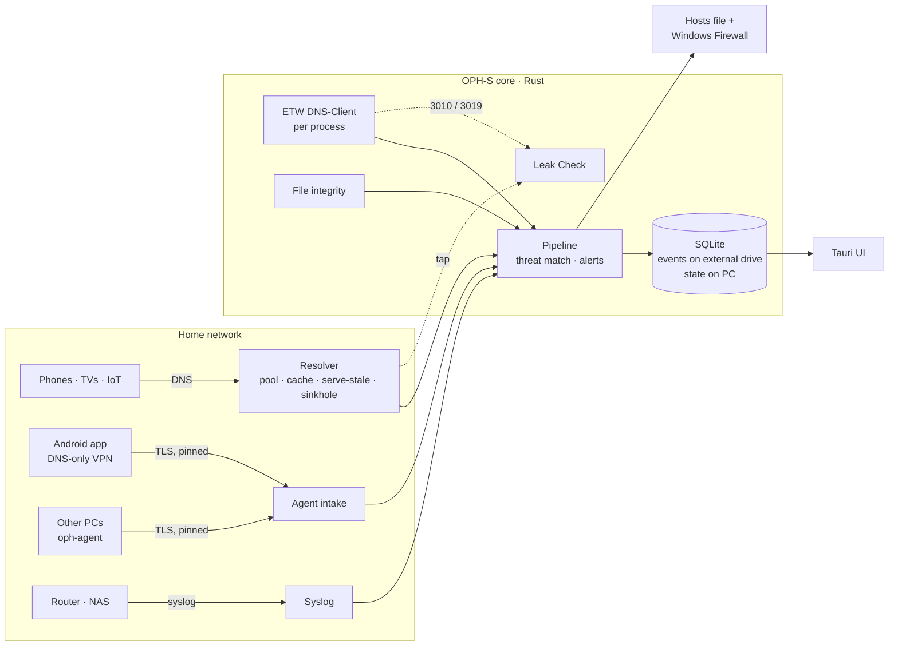

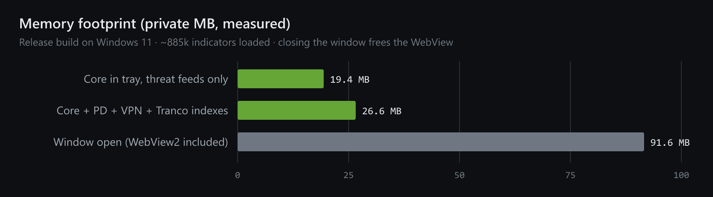

## Engineering notes

- **Resolver reliability:**
  - a socket pool with per-socket health checks
  - a parallel race across fallback resolvers, and coalescing of identical in-flight queries
  - a TTL cache with RFC 8767 serve-stale, so devices stay online through upstream outages
  - 2000 of 2000 queries answered in the load test
- **Hot-path discipline:** the resolver never blocks on analysis. Leak Check reads a bounded queue that drops when full, and all matching runs on its own thread.
- **Security boundaries:**
  - an agent's identity comes from its server-side key, never from client claims
  - input is sanitised at the protocol boundary
  - the hosts file is rewritten atomically with a backup
  - the cleaner refuses unsafe roots and keeps undo manifests
- **Detection quality:** shared hosting platforms and popular sites are separated by evidence (how many subdomains are listed), not by a blanket allowlist. This removed 19,500 false entries without losing phishing on site builders.
- **Process:** every release went through an adversarial QA agent and an independent verifier. Each finding was fixed with a regression test (`cargo test --workspace`).
- **Reuse:** hickory-proto, rustls, ferrisetw, notify, syslog_loose, psl, rusqlite, Suricata (optional), uPlot, Lucide, IBM Plex.

## Install

1. Download `OPH-S_<version>_x64-setup.exe` from [Releases](https://github.com/op-h/OPH-S/releases) and run it. The installer sets up autostart, and uninstalling removes its firewall rules and hosts entries.
2. Point your router's DHCP DNS at the PC. On TP-Link Deco, OPH-S can do this for you from the Router page. Other routers: [docs/SETUP.md](docs/SETUP.md).
3. Optional: install `OPH-S.apk` on Android phones, or `oph-agent.exe` on other PCs, from the Devices page.

## Build

```powershell
cargo test --workspace
cargo build --release -p oph-sentinel -p oph-agent
powershell -ExecutionPolicy Bypass -File scripts\build-installer.ps1   # NSIS installer
```

Requires Rust (MSVC), Visual Studio Build Tools and WebView2. The Android app builds with Gradle in `android/`. To regenerate README media: `cd docs/media && npm install && npm run capture`.

## Repository layout

```
app/src-tauri   Rust core: dns, leak, intel, etw, fim, ingest, router, deco, ai, storage, cleaner
app/ui          static UI without a framework; design tokens in css/tokens.css
crates/         shared wire protocol and the cross-platform agent
android/        Kotlin / Compose companion app
docs/           API contract, setup guide, media capture
```

## License

MIT © OPH

<sub>DONE by OPH</sub>
